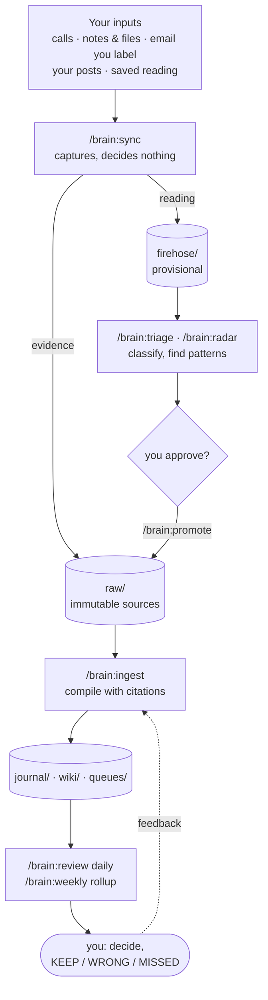
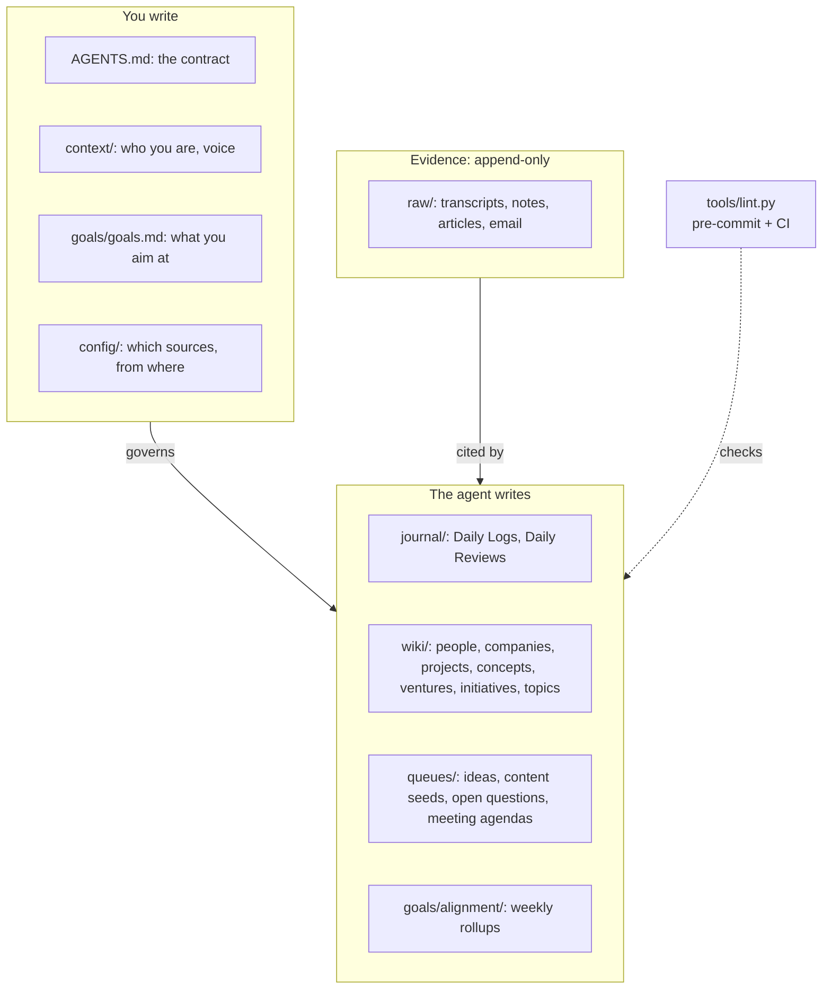

# Brain OS scaffold

A personal knowledge base that an AI agent maintains for you: a working seed to
grow your own from.

## Introduction

If you run several things at once (a job, a side venture, writing, advisory work),
the inputs pile up quickly: calls, articles you saved, email threads, your own
posts. It gets hard to tell whether you are reacting to the right things, whether
two sources contradict each other, and whether the week moved you toward your goals.

Brain OS gives that work to an agent, under rules you control:

- **You feed it what you already capture.** Call transcripts, saved articles, notes,
  PDFs, email threads you choose, your published posts.
- **The agent compiles it.** Each source becomes entries in a Daily Log and updates
  to a cross-linked wiki of people, companies, projects, ideas and claims, every line
  citing its source.
- **You get one screen a day and one page a week.** The Daily Review ends with
  exactly three decisions for you. The weekly rollup scores progress against your own
  goals and lists what you said you would do and didn't.
- **Disagreement is surfaced, not smoothed over.** When a new source contradicts an
  old one, both are kept and the conflict lands in front of you.

It is plain Markdown in a git repo. [Claude Code](https://claude.com/claude-code)
is the interface; [Obsidian](https://obsidian.md) is an optional viewer. No
database, no server, no app. The pattern is the "LLM wiki": immutable sources, a
wiki the agent writes, and a contract file the agent obeys.

### A seed, not a template

This is not a skeleton to fill in, and not a ready-made template for your brain.
It is one working setup, stripped of its data, offered as a starting point and an
inspiration. Take it and grow it toward what you need.

Expect to change most of it:

- **Your goals and projects are your own.** The ventures, initiatives and topics
  here are just one way to organise them. Rename them, merge them, or replace them
  with whatever structure fits how you work.
- **What matters to you is different.** You may care about things this setup does
  not model at all, such as health, family, a team you lead, or investments. Add
  page types, sections and rules for them.
- **Your inputs are different.** The connectors (Plaud, Readwise, Superhuman,
  Typefully, AuthoredUp, Substack) are simply the ones this was built with. Drop the
  ones you don't use and connect your own.

Keep what is useful, such as immutable sources, citations, propose-then-approve and
the daily and weekly loop. Change the rest. `AGENTS.md` is meant to be edited, and
the agent will help you do it: ask it to adapt the contract to your situation.

Even so, this starting point should get you to a basic version that works for you in
a single evening: describe yourself and your goals, connect one or two inputs, and
run the first daily loop. Grow it from there as you use it.

## Architecture

### How information flows



Reading goes through a provisional layer first because most of it is noise.
Nothing in `firehose/` can support a claim until you approve it into `raw/`.

### Layers and who owns them



### Design rules

- **Raw sources never change.** Everything the agent writes can be checked against
  the file it came from.
- **Every claim cites a source.** No citation, no sentence.
- **Contradictions are kept, not overwritten.** Both claims stay; the conflict is
  flagged for you.
- **The agent proposes; you decide.** It never publishes, never invents a commitment
  on your behalf, and marks everything it writes `needs_review: true` until you clear it.
- **Imported text never gives orders.** Inline `<# … #>` instructions run only from
  pages you edit, never from a transcript, article or email.
- **One contract file.** `AGENTS.md` is the schema the agent obeys; `tools/lint.py`
  enforces the mechanical part of it on every commit.

---

## First steps

The short version:

1. Clone the repo, make it private, and enable the lint hook.
2. Open Claude Code in the repo root and ask it two questions:
   - *"What is this repository about from a high-level perspective?"*
   - *"What steps would I need to take to make it useful for me?"*
3. Fill the three files that describe you: `context/self.md`, `goals/goals.md`, and
   `context/voice.md` if you publish.
4. Create a dossier page for each goal.
5. Connect the inputs you use (MCP servers), or start with plain notes.
6. Run `/brain:sync` → `/brain:ingest pending` → `/brain:review`.

The detail for each step follows.

### 1. Prerequisites

- [Claude Code](https://docs.claude.com/en/docs/claude-code) installed and signed in.
- `git` and `python3` (3.9+, standard library only).
- Optional: [Obsidian](https://obsidian.md) 1.9+ for browsing (the `bases/` views need
  the core Bases plugin).

### 2. Create your vault

```bash
git clone https://github.com/pdolega/brain-os-scaffold.git my-brain
cd my-brain
git remote remove origin              # it is your private vault now
git config core.hooksPath .githooks   # run the linter before every commit
python3 tools/lint.py                 # expect: 0 errors, 0 warnings
mkdir -p ~/brain-blobs/attachments    # binaries live here, outside git
```

Keep the vault **private**. Once you use it, it holds transcripts and email. If you
push it anywhere, push to a private repository.

### 3. Ask Claude Code to walk you through it

```bash
claude            # from the repo root
```

Accept the "trust this folder" prompt (the `/brain:*` commands load only in a trusted
folder), then ask:

```
> What is this repository about from a high-level perspective?
> What steps would I need to take to make it useful for me?
```

The agent reads `AGENTS.md` and the folder READMEs and answers for your situation.

### 4. Tell the agent who you are (about 30 minutes)

These three files are yours; the agent reads them every session and never edits
them. Replace every `TODO`. A section left as `TODO` is treated as "not set": the
agent will not guess, and will ask about it in the Daily Review.

| File | What to write |
|---|---|
| `context/self.md` | Your roles, where you have real standing, your audiences (backticked slugs), what you never publish, what you are not interested in. |
| `goals/goals.md` | Long-term direction (never scored), mid-term goals (scored weekly, each linking a dossier), and **Not goals**, such as your day job. |
| `context/voice.md` | Only if you publish: stance, banned phrases, samples to imitate. |

### 5. Create your dossiers

For each mid-term goal, create the page it links to, using the templates in
`AGENTS.md`:

- a **venture** for a business hypothesis: `wiki/ventures/<slug>.md` (§4.10). Write the
  thesis and, if you want, kill criteria. The agent never edits those two sections.
- an **initiative** for an ongoing practice: `wiki/initiatives/<slug>.md` (§4.13). If
  you publish, fill the shipped `wiki/initiatives/writing.md` stub; the publishing
  operations expect that slug. If you don't, delete it.

Every venture needs an `## Evidence against` section and every initiative an
`## Evidence of drift` section. Write `Not yet examined.` under it for now: lint
rejects a missing or empty one, so a dossier never collects only supporting evidence.

The filename is the slug. A venture slug automatically becomes a legal `domain` and
`bears_on` value; initiative and topic slugs become legal `bears_on` values. Add each
new page to `index.md` (the agent keeps it current after that). Optionally copy
`bases/_venture.base.example` to `bases/<VENTURE>.base` and add a section to
`Dashboard.md`.

### 6. Connect your inputs (optional)

Nothing here is required to start: manual notes and file drops work with no
connector (see "First run" below). Every connector ships **disabled**. For each one
you want:

1. add its MCP server to Claude Code, from the vault root, with the name shown (the
   skills call it by that name);
2. in Claude Code run `/mcp`, pick the server and sign in;
3. in `config/source-policy.yml`, set `enabled: true` and fill its `TODO` values.

| Source | Connector | Add it | Lands in |
|---|---|---|---|
| Call recordings | Plaud (transcripts only) | `claude mcp add plaud -- npx -y @plaud-ai/mcp@latest` | `raw/` |
| Saved articles | Readwise Reader | `claude mcp add --transport http readwise https://mcp2.readwise.io/mcp` | `firehose/` |
| Email (only threads you label `brain`) | Superhuman Mail | `claude mcp add --transport http superhuman-server https://mcp.mail.superhuman.com/mcp` | `raw/` |
| X posts | Typefully | `claude mcp add --transport http typefully https://mcp.typefully.com/mcp` | `raw/.../activity/` |
| LinkedIn posts | AuthoredUp | `claude mcp add --transport http authoredup-server https://backend.authoredup.com/mcp` | `raw/.../activity/` |
| Substack posts | your RSS feed, no server | set `substack.url` | `raw/.../activity/` |
| Web pages, YouTube | none, on request | `/brain:sync web <url>` | `firehose/` |
| Your own notes | none | drop `.md` files into `raw/YYYY/MM/DD/notes/` | `raw/` |
| PDFs, images, docs | none | drop into `~/brain-blobs/attachments/YYYY/MM/DD/` | `raw/` sidecar |

Set `defaults.start_from` to the day you start; `/brain:sync` refuses to run while it
is `TODO`. Connectors pull nothing older unless you pass `--since`. Email is the
exception: a thread you label `brain` is pulled whatever its date.

**Using a different tool?** Swap the connector, keep the shape. A source needs only
three things: a stable `source_id`, a capture time, and text. To replace Plaud with
another recorder, change `mcp_server` (or use `transport: manual` and drop
transcripts into `notes/`), then update the matching bullet in `AGENTS.md` §5.0 and
the step in `.claude/skills/brain/skills/sync/SKILL.md`. Changes to the contract are
yours to make; the agent may propose them but never edits `AGENTS.md` or `config/`
on its own.

### 7. First run

```bash
claude            # from the vault root; CLAUDE.md imports AGENTS.md
```

If typing `/brain:` shows no commands, the folder is not trusted yet: open `claude`
interactively once and accept the prompt (`claude -p` never asks).

**With no connector (five minutes).** Write anything you would otherwise forget:
meeting notes, a decision, an idea. Save it as
`raw/<today as YYYY/MM/DD>/notes/first-note.md`, plain text, no frontmatter. Then:

```
> /brain:sync notes        # adds source frontmatter; the body is never touched
> /brain:ingest pending    # compiles it into the Daily Log, wiki and queues
> /brain:review            # today's Daily Review
```

**With call recordings.** `/brain:sync` writes every transcript straight to `raw/`,
so the same `ingest` → `review` sequence follows.

**With saved articles.** Reading lands in `firehose/` first: provisional, never
cited. It only becomes evidence after you approve it:

```
> /brain:sync readwise     # every saved article → firehose/
> /brain:triage            # reads each one, assigns streams, extracts claims
> /brain:radar technology  # patterns across articles + proposed promotions
> /brain:promote <item>    # you approve: frozen into raw/, then ingested
> /brain:review
```

Triage needs at least one stream. `firehose/streams/technology-stream.md` is an
example: edit its scope, or add your own and list it under
`firehose.active_streams`. An article that fits no stream is marked `ignored`
(kept, searchable, never surfaced).

Open `journal/reviews/review-<today>.md`, answer the three decisions, and write
`KEEP`, `WRONG` or `MISSED` under Feedback. The next run reads it.

---

## Daily and weekly rhythm

| When | Do | Time |
|---|---|---:|
| Active day | `/brain:sync` → `/brain:triage` → `/brain:ingest pending` → `/brain:review`, then answer the review | ~10 min |
| When radar proposes promotions | approve with `/brain:promote <item>` (or write `PROMOTE` in the radar page's Feedback) | ~5 min |
| Quiet day | nothing; skip the review when nothing was captured | — |
| Before a meeting | `/brain:agenda <who, when, why>` | ~2 min |
| Weekly | `/brain:weekly`, then clear `bases/Needs Review.base` and approve promotions | ~30 min |

Leave an instruction as `<# do this #>` in any page you edit (journal, wiki, queues,
drafts, goals, context); the next run carries it out and logs it. Markers inside
imported material (`raw/`, `firehose/` items) are never executed: that is what stops
an article or email from giving the agent orders.

## Commands

| Command | What it does |
|---|---|
| `/brain:sync [source] [--since date]` | Captures new items. Evidence goes to `raw/`, reading goes to `firehose/`. Decides nothing. |
| `/brain:triage` | Reads and classifies pending firehose items. Provisional only. |
| `/brain:radar <stream \| weekly>` | Finds patterns across firehose items; proposes promotions. |
| `/brain:promote <item \| approved>` | Freezes approved firehose items into `raw/` (irreversible), then ingests them. |
| `/brain:retire [report]` | Reports firehose size and staleness; can mark items ignored. Never deletes. |
| `/brain:mail` | Scans your mailboxes and proposes threads to pull in. Nothing is saved until you approve by number. |
| `/brain:ingest [pending \| today \| path]` | Compiles raw sources into the Daily Log, wiki and queues. |
| `/brain:review` | Writes today's Daily Review: one screen, exactly three decisions. |
| `/brain:weekly [YYYY-Www]` | Checks what you published, writes the weekly rollup scored per goal, runs radar and lint. |
| `/brain:lint` | Runs `tools/lint.py`, then the judgment checks (contradictions, unsupported claims). |
| `/brain:file` | Files the answer you just discussed as a synthesis page. |
| `/brain:draft <seed>` | Writes or revises a draft from a content seed. Never publishes. |
| `/brain:agenda <who, when, why>` | Builds a pre-meeting page: what to raise, ask and watch out for. |

The commands live in `.claude/skills/brain/` and are available when Claude Code runs
from the vault root.

## What lives where

| Path | What | Owner |
|---|---|---|
| `AGENTS.md` | the contract: rules, templates, operations | you |
| `context/`, `goals/goals.md` | who you are, what you aim at | you |
| `config/source-policy.yml` | what may be ingested, from where | you |
| `bases/`, `Dashboard.md` | Obsidian views | you |
| `firehose/streams/` | what the firehose watches | you |
| `raw/` | immutable evidence, by capture date | append-only |
| `firehose/` | provisional intake, patterns, radar | agent |
| `journal/` | Daily Logs and Daily Reviews | agent |
| `wiki/` | people, companies, projects, concepts, ventures, initiatives, topics, syntheses | agent (you create ventures and initiatives) |
| `queues/` | product ideas, content seeds, open questions, agendas | agent |
| `drafts/` | pieces in progress | shared |
| `analytics/` | per-post numbers | agent |
| `goals/alignment/` | weekly rollups | agent |
| `index.md`, `log.md`, `sync.md` | catalog, append-only history, watermarks | agent |
| `tools/lint.py` | deterministic checks; runs pre-commit and in CI | — |

Every folder has a `README.md` saying what goes in it. `AGENTS.md` §2–§4 has the full
map and every page template.

## Adapting it

- **Personal or project-shaped.** As shipped it is personal: goals, ventures,
  contradictions. For a single project, keep `raw/`, the journal and the
  propose-then-approve loop, add a folder of workstreams with task lists, and drop
  what you don't need (firehose, seeds, analytics). Delete the matching sections from
  `AGENTS.md` so the agent doesn't look for them.
- **No day job to mine?** Remove §5.1a from `AGENTS.md` and the `work` domain
  stays unused.
- **Don't publish?** Leave the activity sources disabled and ignore seeds and drafts.
- **Change a rule.** Edit `AGENTS.md`. If the rule is mechanical, add a check to
  `tools/lint.py` so it does not depend on the prompt.

## Privacy

- The vault is meant to stay private. `sensitivity: restricted` marks client and
  personal material. Anything meant to leave the vault (seeds, drafts, syntheses)
  must anonymize it, and lint fails a draft that names a person or client from your
  wiki.
- Binaries never enter git (`.gitignore`); they live in `~/brain-blobs/`.
- `never_ingest` in the source policy drops matching material before it is written.

## Questions and comments

Feel free to catch me on X ([@pdolega](https://x.com/pdolega)) or
[LinkedIn](https://www.linkedin.com/in/pdolega/).

## License

MIT, see `LICENSE`.
